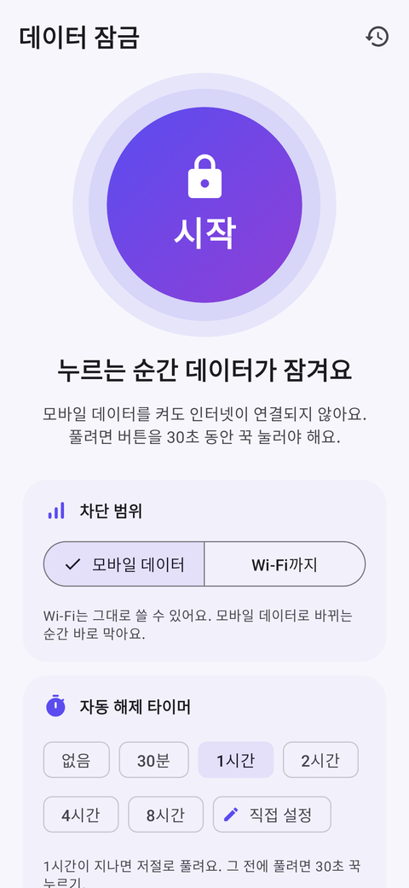
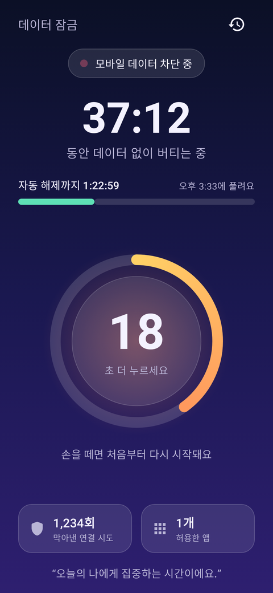
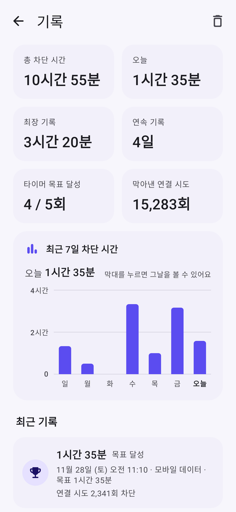

# 데이터 잠금 (DataLock)

**시작**을 누르면 모바일 데이터를 켜도 인터넷이 연결되지 않게 막아 주는 안드로이드 앱입니다.
다시 풀려면 버튼을 **30초 동안 꾹** 눌러야 해서, 습관처럼 데이터를 켜는 걸 막아 줍니다.

| 시작 화면 | 차단 중 (30초 꾹 누르는 중) | 기록 |
| --- | --- | --- |
|  |  |  |

<sub>스크린샷의 기록과 숫자는 예시 데이터입니다.</sub>

## 설치

1. 휴대폰에서 [`release/DataLock-1.2.0.apk`](release/DataLock-1.2.0.apk)를 내려받습니다(GitHub 파일 화면의 다운로드 버튼).
2. 내려받은 파일을 엽니다. "출처를 알 수 없는 앱" 설치를 허용할지 물으면 허용합니다.
3. Play 프로텍트가 앱 검사를 권하거나 경고를 띄울 수 있습니다. 직접 만든 앱이라 그런 것이니, 내용을 확인한 뒤 설치를 계속하면 됩니다.
4. 앱을 열고 **시작**을 누릅니다. 처음 한 번은 안드로이드의 **VPN 연결 요청** 창이 뜨는데, **확인**을 누르면 됩니다.

안드로이드 8.0 이상에서 동작합니다.

## 기능

### 요청하신 기능

- **시작 버튼**: 누르는 순간 데이터가 차단됩니다. 데이터(LTE/5G)를 켜도 앱들이 인터넷에 연결되지 않습니다. 차단 중에는 상단 상태 표시줄에 열쇠 모양 VPN 아이콘이 보입니다.
- **30초 꾹 눌러서 해제**: 차단이 시작되면 시작 버튼 자리에 해제 버튼만 나타납니다. 버튼을 30초 동안 계속 누르고 있어야 풀리고, 중간에 손을 떼면 처음부터 다시 시작합니다. 누르는 동안 남은 초가 크게 표시되고, 화면이 꺼지지 않으며, 5초마다 진동이 옵니다.
  - 30초는 시스템 시계로 잽니다. 안드로이드 설정에서 애니메이션을 꺼도 짧아지지 않습니다.
- 해제하면 데이터는 바로 정상으로 돌아옵니다.

### 덧붙인 기능

- **차단 범위 선택**: "모바일 데이터"(Wi-Fi는 그대로 사용 가능, 기본값) 또는 "Wi-Fi까지"(모든 인터넷 차단).
- **자동 해제 타이머**: 30분, 1시간, 2시간, 4시간, 8시간, 또는 직접 설정. 시간이 되면 저절로 풀리고 "목표 달성!" 알림이 옵니다. 그 전에 풀려면 여전히 30초 꾹 누르기가 필요합니다.
- **허용할 앱**: 카카오톡처럼 꼭 필요한 앱만 골라 차단 중에도 인터넷을 쓰게 할 수 있습니다. 차단 중에는 목록을 바꿀 수 없습니다. "Google Play 서비스"를 허용하면 다른 앱의 푸시 알림이 계속 올 수 있습니다.
- **기록과 통계**: 총 차단 시간, 오늘, 최장 기록, 연속 기록(며칠 연속으로 했는지), 타이머 목표 달성 횟수, 막아낸 연결 시도 수, 최근 7일 막대그래프, 세션별 기록.
- **빠른 설정 타일**: 알림창의 빠른 설정에 "데이터 잠금" 타일을 추가하면 한 번에 시작할 수 있습니다. 차단 중에 누르면 해제 화면만 열립니다.
- **쉽게 꺼지지 않게**: 알림에는 해제 버튼이 없습니다. 앱을 닫거나, 강제 종료했다가 다시 열거나, 휴대폰을 껐다 켜도 차단이 다시 이어집니다. 차단 중에 설정에서 VPN을 끊어도 **세션이 끝나지 않고** 유지되며, 다시 연결하라는 알림이 뜹니다(해제는 여전히 30초 꾹 누르기로만).
- **VPN 설정 잠그기 (차단 지킴이)**: 접근성 서비스 "데이터 잠금 차단 지킴이"를 켜 두면, 차단 중에 VPN 설정 화면·알림창의 VPN 연결 끊기 창·다른 VPN 앱·다른 VPN의 연결 허용 창이 열리자마자 닫힙니다. 그래서 차단 중에는 VPN을 끄거나 다른 VPN으로 갈아탈 수 없습니다. 차단이 꺼져 있을 때는 아무것도 하지 않고, 화면 내용을 저장하거나 밖으로 보내지 않습니다. 직접 설치한 앱이라 안드로이드 13 이상에서는 처음에 "제한된 설정"으로 막힐 수 있는데, 앱 정보 → ⋮ → "제한된 설정 허용" 후 켜면 됩니다.
- **더 강력하게 잠그기 (선택)**: 안드로이드의 **"항상 VPN 사용"**과 **"VPN 없이 연결 차단"**을 이 앱에 켜 두면, 차단 중에 VPN을 끄기 어려워지고 설령 꺼지더라도 안드로이드가 직접 데이터를 막습니다. 시작 화면의 "더 강력하게 잠그기" 카드에서 **VPN 설정 열기** 버튼으로 바로 갈 수 있습니다. 이 모드에서는 "허용할 앱" 예외가 동작하지 않고 모든 데이터가 막힙니다.
- **차단 중 화면**: 차단을 유지한 시간, 타이머가 풀리는 시각, 막아낸 연결 시도 수와 응원 문구를 보여 줍니다.

## 이렇게 작동해요

- 안드로이드는 일반 앱이 모바일 데이터 스위치를 직접 끄지 못하게 막아 둡니다(시스템 앱만 가능). 그래서 안드로이드의 **VPN 기능**을 씁니다. 휴대폰 안에 VPN 통로를 만들어 모든 인터넷 연결을 그쪽으로 보낸 다음, 아무 데도 보내지 않고 버립니다.
- 실제 VPN 서버는 없습니다. 이 앱은 어떤 데이터도 밖으로 보내지 않습니다.
- 앱이 연결을 시도하면 기다리게 두지 않고 곧바로 "연결 거부"로 답합니다. 그래서 다른 앱들은 한참 로딩하지 않고 바로 "인터넷 연결 없음"을 표시합니다.
- "모바일 데이터" 모드에서는 Wi-Fi에 연결된 동안 VPN을 잠시 내려 Wi-Fi를 쓰게 하고, 모바일 데이터로 바뀌는 순간 다시 막습니다.
- **"항상 VPN 사용"을 켰을 때**: 세션이 없어도 안드로이드가 앱을 깨우면 자동으로 "제한 없음" 상태의 상시 차단 세션을 시작합니다. "VPN 없이 연결 차단"까지 켜 두면, VPN이 잠깐 꺼지는 순간에도 안드로이드가 데이터를 막습니다.
- 전화와 문자 메시지(SMS)는 영향을 받지 않습니다.

## 알아 둘 점

- 일반 앱은 자기 VPN을 사용자가 **영영 못 끄게** 만들 수 없습니다. 안드로이드 **설정 > VPN**에서 연결을 끊거나, 앱을 강제 종료·삭제하는 길은 안드로이드가 보장하는 안전장치라 막을 수 없습니다. 다만 이 앱은 차단 중에 VPN이 끊겨도 세션을 끝내지 않고 "다시 연결" 알림만 띄웁니다. 진짜로 못 끄게 하려면 위의 **"항상 VPN 사용" + "VPN 없이 연결 차단"**을 쓰세요(그마저도 끄려면 설정에서 직접 꺼야 하므로, 사용자는 항상 최종 통제권을 가집니다).
- 다른 VPN 앱과 동시에 쓸 수 없습니다. 다른 VPN을 켜면 차단이 "다시 연결 필요" 상태가 됩니다.
- "모바일 데이터" 모드에서 Wi-Fi가 끊기고 데이터로 넘어가는 아주 짧은 순간(1초 미만)에는 일부 연결이 통과할 수 있습니다. 확실히 막으려면 "Wi-Fi까지" 또는 위의 강력 잠금을 쓰세요.
- 나중에 새 버전을 다른 환경에서 빌드하면 서명 키가 달라져서, 기존 앱을 지운 뒤 설치해야 할 수 있습니다(기록도 함께 지워집니다).

## 직접 빌드하기

JDK 17 이상과 Android SDK(플랫폼 36)가 필요합니다.

```bash
cd DataLock
./gradlew assembleRelease
```

- 결과물은 `app/build/outputs/apk/release/app-release.apk`입니다.
- `DataLock/keystore.properties`(`storeFile`, `storePassword`, `keyAlias`, `keyPassword`)가 있으면 그 키로 서명하고, 없으면 디버그 키로 서명합니다. 이 파일과 키 파일은 저장소에 올리지 않습니다.
- 테스트: `./gradlew test` (즉시 거부 응답 패킷, 시간 표시, 통계).
- 화면 스크린샷: `./gradlew :app:testDebugUnitTest -Pscreenshots --tests '*ScreenshotTest'` → `app/build/screenshots/` (처음 한 번은 Robolectric용 안드로이드 이미지를 내려받습니다).

## 코드 구조

```
app/src/main/java/io/github/joyong133/datalock/
  MainActivity.kt   VPN 연결 동의와 알림 권한을 받고 화면을 띄움
  core/             세션 저장(Store), 공유 상태(BlockState), 시작·재개·종료(BlockController),
                    자동 해제 알람, 알림, 시간 표시, 통계
  vpn/              BlockVpnService(차단용 VPN), Tunnel(패킷을 버리는 통로),
                    PacketResponder(즉시 거부 응답), NetworkWatcher(Wi-Fi/모바일 데이터 감지)
  receiver/         재부팅·업데이트 후 차단 재개, 타이머 종료
  tile/             빠른 설정 타일
  ui/               Compose 화면: 시작, 차단 중(30초 버튼), 허용할 앱, 기록, 주간 그래프
```
